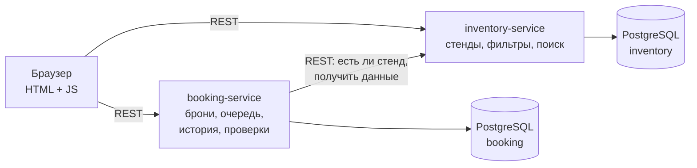

# Test Bench Inventory (ТЗ)

Учебный проект по курсу backend-разработки.

## Описание

Сервис для учёта тестовых стендов отдела QA, что-то вроде упрощённого GLPI. В базе лежит примерно 80–100 стендов (ноутбуки, ПК, серверы). Для каждого известны железо и место, где он стоит. Стенд можно найти через фильтры, забронировать на время, а потом отметить, какие проверки по задаче на нём уже прошли.

В GLPI нам не хватало двух вещей, и мы их добавляем:
- **очередь ожидания** на занятый стенд: встаёшь в очередь, и когда бронь заканчивается, стенд автоматически переходит следующему;
- **история загрузки**: кто, когда и сколько занимал стенд, плюс простая статистика: какие стенды простаивают, а какие нарасхват.

## Основная функциональность

1. **Каталог стендов**
   - список стендов с пагинацией;
   - фильтры по типу (ноутбук / ПК / сервер), CPU, объёму RAM, ОС, месту (здание, кабинет);
   - поиск по ключевому слову (имя стенда, инвентарный номер, модель);
   - карточка стенда с характеристиками и текущим статусом (свободен / занят).
2. **Бронирование**
   - забронировать свободный стенд на период (с — по);
   - нельзя забронировать стенд, если периоды пересекаются;
   - отменить бронь или освободить стенд раньше срока.
3. **Очередь ожидания**
   - если стенд занят, можно встать в очередь;
   - после окончания или отмены брони стенд бронируется на первого в очереди.
4. **История и статистика**
   - история бронирований по каждому стенду;
   - процент загрузки стенда за выбранный период, топ свободных и занятых стендов.
5. **Страница прогресса проверок**
   - таблица: строки — стенды, столбцы — проверки;
   - список проверок пока фиксированный: сбор логов производительности, сбор системных логов, тестирование ядра, проверка драйверов, стресс-тест;
   - QA-инженер ставит галочки, видно, кто и когда отметил проверку.

Авторизации пока нет: при бронировании и отметке проверок пользователь просто вводит своё имя. Позже, если успеем, добавим логин.

Данные (стенды) при первом запуске заполняются SQL-скриптом.

## Участники и распределение работы

| Участник | Зона ответственности |
|---|---|
| Участник 1 (ФИО) | `inventory-service`: модель стендов, БД, скрипт заполнения, фильтры и поиск, REST API каталога. Frontend: страница каталога и карточка стенда. |
| Участник 2 (ФИО) | `booking-service`: бронирования, проверка пересечений, очередь ожидания, история и статистика, чек-лист проверок. Frontend: страница бронирований и страница прогресса проверок. |
| Вместе | `docker-compose`, общий README, схема архитектуры, интеграция сервисов между собой. |

Разделение сделано по сервисам: каждый ведёт свой сервис от БД до REST API и свои страницы на фронте. Так по коммитам видно, кто что сделал, и мы меньше мешаем друг другу. Точка, где работа пересекается, — это REST-вызов из `booking-service` в `inventory-service`. Контракт этого вызова договариваемся зафиксировать заранее.

## Архитектура

Два сервиса на Spring Boot, у каждого своя база PostgreSQL (по схеме на сервис в одном контейнере Postgres). Frontend — статические HTML/CSS/JS страницы, они ходят в API обоих сервисов.

Как это работает:
- `inventory-service` отвечает только за стенды. О бронях он ничего не знает.
- `booking-service` при создании брони спрашивает у `inventory-service`, есть ли такой стенд и не списан ли он. Статус «занят» считается по таблице броней.
- Очередь ожидания обрабатывает задача по расписанию (`@Scheduled`) в `booking-service`. Раз в минуту она закрывает истёкшие брони и отдаёт стенд следующему в очереди.

Позже, возможно, добавим RabbitMQ: `booking-service` будет отправлять событие «стенд освободился» вместо синхронной проверки.

## Технологии

- Java 17, Spring Boot 3 (Web, Data JPA, Validation)
- Maven
- PostgreSQL 16, Flyway для миграций и заполнения данными
- Docker, docker-compose
- Frontend: HTML, CSS, чистый JavaScript (fetch)
- Тесты: JUnit 5, Testcontainers (если успеем)

## Запуск

Будет описан, когда появятся сервисы. План такой: `docker compose up --build`.
